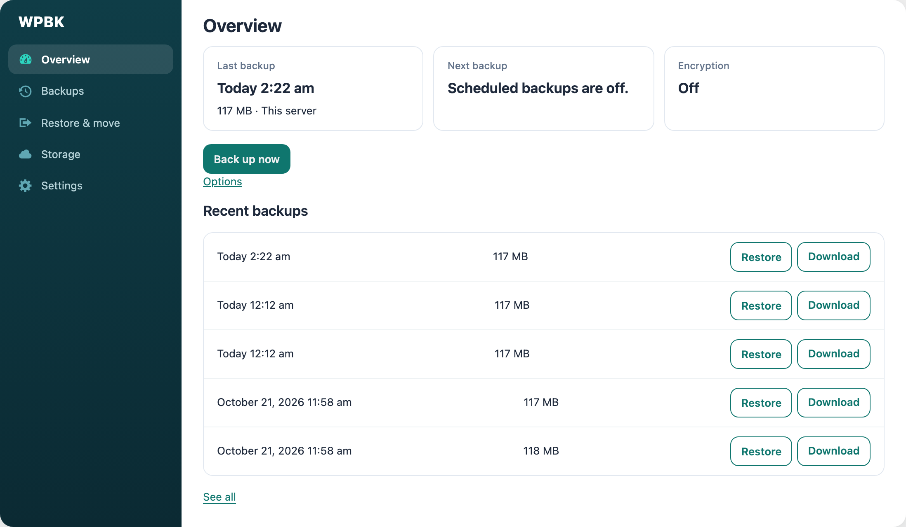
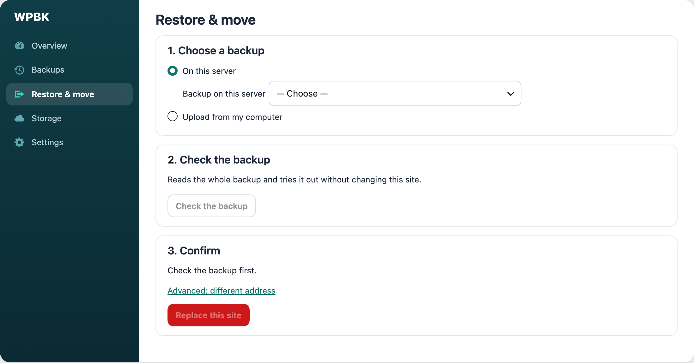

# WPBK Backup & Migrate

Back up a whole WordPress site into one file, and restore it onto the same site or move it to another one.

**[⬇ Download the latest version](https://github.com/nivobi/wpbk-releases/releases/latest)**

## What it does

- **One-click backups** of the database, uploads, plugins and themes into a single `.wpbk` file.
- **Scheduled backups** daily, weekly, monthly or quarterly, with old copies cleaned up automatically.
- **Off-site storage** on Google Drive, Dropbox, S3-compatible storage or an SFTP server.
- **Restore and move** a site in a few guided steps. The backup is checked before anything changes, and a safety
  snapshot is taken first so a failed restore rolls back.
- **Moves to a new address** by rewriting the site URL everywhere, including inside serialized data.
- **Encryption** of backups with a password of your choice.
- **Email alerts** when a scheduled backup fails.
- **Made for shared hosting**: work runs in small resumable steps, so low time and memory limits are fine.

## Install

1. Download `wpbk-<version>.zip` from the [latest release](https://github.com/nivobi/wpbk-releases/releases/latest).
2. In WordPress, go to **Plugins → Add New Plugin → Upload Plugin**, choose the zip and click **Install Now**.
3. Click **Activate**. The dashboard is under **WPBK Backup** in the admin menu.

Nothing runs on its own until you turn it on.

## Updates

Once installed, new versions appear under **Plugins** like any other plugin, and WordPress's auto-update toggle
works too. Sites check this repository about twice a day; **Dashboard → Updates → Check again** checks at once.

## Requirements

- WordPress 6.6 or newer (single site; multisite is not supported yet)
- PHP 7.4 or newer

## Keep your backups safe

A backup holds your whole site, including user accounts and anything stored in the database. Treat backup files
like passwords: store them somewhere private, or turn on encryption.

## About this repository

This repository only publishes releases. Each release has the plugin zip and notes on what changed; [CHANGELOG.md](CHANGELOG.md) lists them all. Please report
problems to the people who installed the plugin for you.

## Licence

GPL-2.0-or-later. See [LICENSE](LICENSE).
